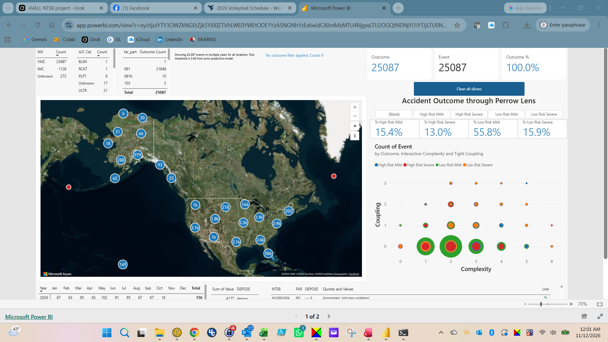

# AVALL Dashboard

Public Power BI operations dashboard of NTSB (National Transportation Safety Board) aviation accidents (2008–2026) viewed through Charles Perrow’s [Normal Accidents](https://en.wikipedia.org/wiki/Normal_Accidents) lens. Events are categorized on the axes of interactive complexity (x) and tight coupling (y).

NTSB investigations are methodical and can take years to run their course. The data set contains USA events only—accidents that occurred within the jurisdiction of the United States. Foreign countries and U.S. territories are excluded.

The dashboard supports filtering by event date, weather (IMC Instrument Meteorological Conditions, VMC Visual Meteorological Conditions), FAR (Federal Aviation Regulations) part, and aircraft category. These four dimensions form the initial filter set for the public-facing view.

The unfiltered view shows 25,087 events. Cards at the top right confirm Outcome = 25,087, Event = 25,087, and Outcome % = 100.0%.

Left-side tables break the events down by weather (VMC; IMC; Unknown ), aircraft category, and FAR part (primarily 091). Parts 91 private, 121 commericial and 135 air taxi are the primary categories we expect explored. 

A North America map clusters events as sized blue circles, with the densest concentrations over the eastern United States. The map supports drill-down through aggregate bubbles and filtering by individual points.

The right-hand section, “Accident Outcome through Perrow Lens,” includes button filters for the four risk–severity combinations: High Risk Mild, High Risk Severe, Low Risk Mild, and Low Risk Severe. Selecting a button filters the page to that combination. The unfiltered distribution is:
- High Risk Mild 15.4%
- High Risk Severe 13.0%
- Low Risk Mild 55.8%
- Low Risk Severe 15.9%

These categories are produced by a predictive model that estimates the probability of a severe outcome. An XGBoost classifier was trained on events before 1 January 2021 and validated on 2021 and later events (ROC-AUC 0.636). Events with predicted probability ≥ 0.40 are labeled high risk. The four combinations therefore compare predicted risk against the actual injury outcome.

The scatter chart plots events by interactive complexity (x-axis) and tight coupling (y-axis). Bubble location encodes the complexity–coupling score; color encodes severity/outcome. Locations that contain multiple colors represent events that share the same complexity and coupling values but differ in severity. Most events sit at low complexity and low coupling; higher values contain fewer events that include both high-risk and low-risk outcomes.

Events receive a DEPOSE (Design, Equipment, Procedures, Operators, Supplies, Environment) score. A category is marked 1 when the corresponding criterion is met. For example, DE----- indicates an event that met the criteria in both the Design and Equipment categories.

The lower-left table lists the NTSB report number, the DEPOSE score, the supporting data that justify the score, and a link icon. Clicking the icon opens the corresponding NTSB report. Partial-year monthly counts for 2026 appear in the same lower strip.

**Live dashboard:**  
https://app.powerbi.com/view?r=eyJrIjoiYTY3OWZkNGEtZjk5Yi00ZTVhLWE0YWEtODE1YzA5NGNhYzEzIiwidCI6ImMzMTU4NjgwLTU2OGQtNDNjYi1iYTJjLTU0NzQyOTNiNDQ5OSJ9

Companion modeling notebook: [../09-avall-pipeline](../09-avall-pipeline/)