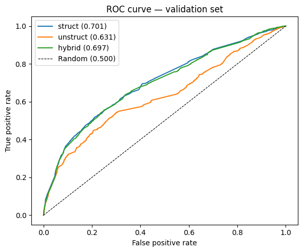
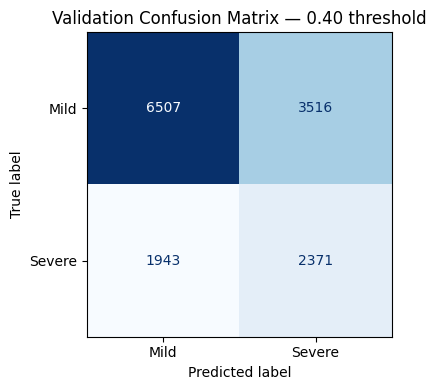
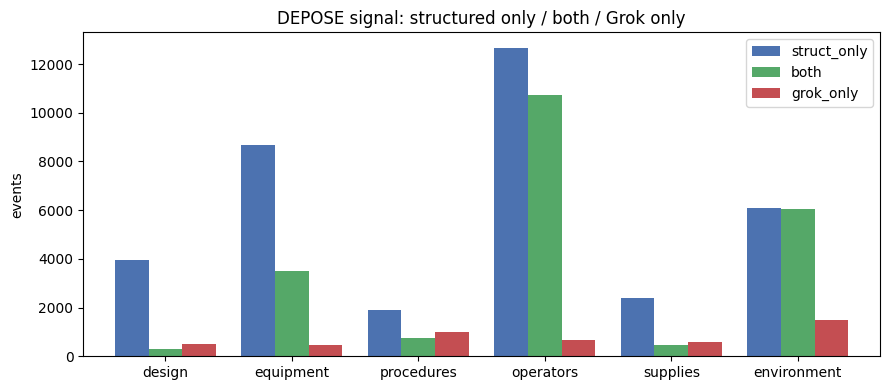
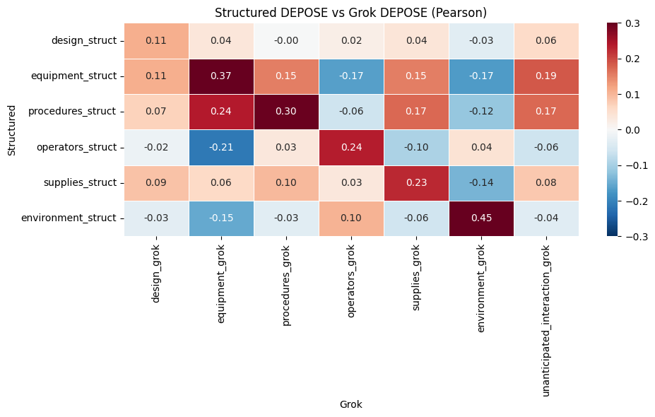
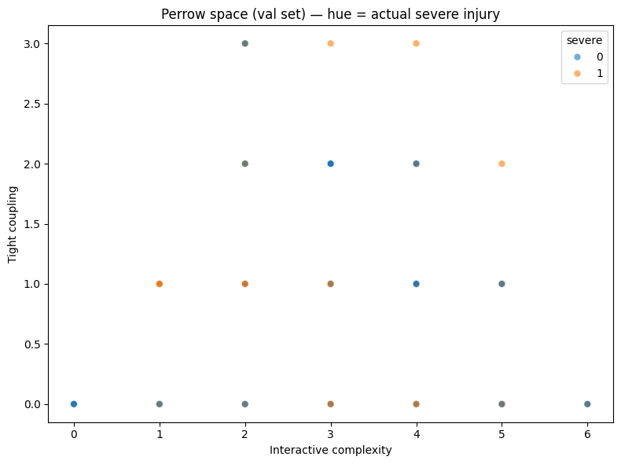

# AVALL — NTSB Aviation Accidents through Normal Accidents
Public-facing Power BI dashboard of NTSB aviation accidents (2008-01-01 to 2026-10-28) framed through Charles Perrow’s Normal Accidents lens.  
Target: surface severe-injury risk, DEPOSE categories, and Contained versus Uncontained outcomes for public review.

## Approach
- Ingest NTSB AVALL extracts into a star schema (FactAccident plus dimensions)
- Pass 1: structured rules map fields to Design, Equipment, Procedures, Operators, Supplies, Environment (DEPOSE)
- Pass 2: Grok narrative classification fills gaps and flags unanticipated interaction
- Train an XGBoost classifier for probability of severe injury (pre-2021 train, 2021+ validation)
- Score Contained (high predicted risk + mild actual) versus Uncontained (high predicted risk + severe actual) at threshold 0.40
- Publish interactive Power BI dashboard filtered to USA events

## Key pieces
- Six structured DEPOSE flags plus audit-trail tags from findings and defining-event descriptions
- Interactive complexity and tight coupling derived from the same tags
- Fixed 0.40 high-risk cutoff with static label on the landing page
- Map, DEPOSE bar chart, and outcome views driven by fact_scored.parquet

## Result
Pipeline and scored fact table ready for public dashboard.

Structured features alone reach the highest discrimination. Unstructured Grok tags add little once the structured flags are present.

At the locked 0.40 threshold the model catches most severe events while still generating a large number of false alarms on mild outcomes.

Most DEPOSE signal comes from structured fields. Grok-only tags are thin; agreement is strongest on Equipment, Operators, and Environment.

Correlation between structured and Grok tags is modest. Highest alignment is on Equipment and Environment; Operators and Procedures show weaker or mixed relationships.

Events occupy discrete cells in Perrow space. Severe outcomes appear across both low and high interactive-complexity / tight-coupling combinations; no single quadrant dominates.

Full code notebook at 09-avall-ntsb/notebook.ipynb. Source extracts and intermediate parquet files omitted from this repository.